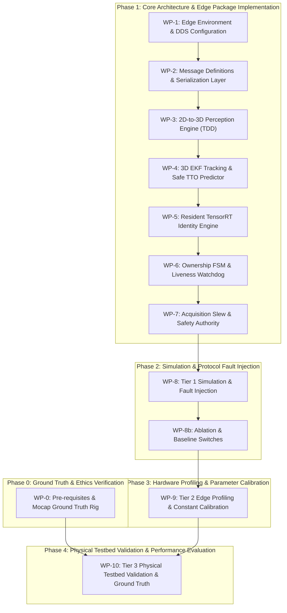

# 🚀 EdgeSync: Master Implementation & Engineering Execution Plan (v1.0)
## Proactive TTO-Driven Decentralized Target Handoff for Dual JetAuto UGVs
**Document Status:** FROZEN & CERTIFIED BASELINE  
**Author / Systems Architect:** Principal Systems Architect & Senior Robotics Engineer  
**Aligned Standards:** SRS v1.3 · SAD v2.3 · Math & Protocol Spec v2.3 · Experimental Design v1.1  
**Target Hardware:** Hiwonder JetAuto UGV (Dual Setup) · NVIDIA Jetson Orin Nano (8GB Unified Memory) · Astra Pro Plus RGB-D · RPLiDAR  
**Target Software Stack:** Ubuntu 22.04 LTS · ROS 2 Humble Hawksbill (`rclpy` exclusively) · FastDDS 2.x · TensorRT 8.6 Python API · PyCUDA / ONNX  

---

## 📌 Executive Summary & Architectural Traceability

This Implementation Plan provides an end-to-end, mathematically rigorous, phased blueprint to translate the frozen system design of **EdgeSync** into verified, production-ready **Python-exclusive (`rclpy`)** ROS 2 packages and embedded edge services. 

The implementation strictly satisfies the **5 System Invariants**:
1. **Zero Dual-Ownership Invariant:** The state `COMMITTED` preserves Robot A as sole owner; ownership transfers strictly upon atomic transmission of `HANDOFF_CONFIRM_ACK` with monotonic epoch `e+1`.
2. **Deterministic Latency Budget:** Total nominal execution budget $\Delta t_{exec} \le 866\text{ ms}$, with an empirical safety margin $\Delta t_{safety} = 364\text{ ms}$, bounding the total allowable handoff window to $\Delta t_{budget}^{max} = 1230\text{ ms}$.
3. **Anti-Deadlock Liveness Invariant:** Continuous 10 Hz `ACQ_STATUS` heartbeats with a 300 ms watchdog cutoff to immediately abort failed candidates (`ERR_CANDIDATE_DEAD`) and revert to solo tracking.
4. **Spatial Reference Consistency:** All inter-robot target states, velocities, and covariances are resolved in the shared `map` coordinate frame via `tf2_ros` and metric depth, with ego-motion noise strictly propagated into measurement covariance ($R_{total}$).
5. **Edge Resource & Resident Inference Invariant:** The 512-dimensional OSNet feature extractor is pre-warmed and resident in unified memory, ensuring zero engine-load latency during the active handoff window.

---

## 📐 Strict Python, SOLID & Testing Directives

To guarantee modularity, maintainability, and academic rigor, the implementation enforces the following non-negotiable architectural mandates:

1. **Python Exclusivity (`rclpy`):**
   * All computational and lifecycle nodes are implemented strictly in Python 3.10 using `rclpy`.
   * Standard ROS 2 Python package structures (`setup.py`, `setup.cfg`, `package.xml`, package namespace directories with `__init__.py`) are used across all functional packages.
   * **Only** `edgesync_msgs` utilizes `CMakeLists.txt` for standard ROS 2 IDL message generation (`rosidl_default_generators`).
2. **SOLID & OOP Design Enforcement (DIP & OCP):**
   * All AI and perception models (YOLO Detector, ByteTrack MOT, OSNet Feature Extractor) MUST inherit from Python Abstract Base Classes (`abc.ABC`).
   * Nodes must depend strictly on abstractions (e.g., `BaseDetector`, `BaseIdentityExtractor`, `BaseStateEstimator`, `BaseTTOPredictor`), never concrete classes. Concrete TensorRT/PyTorch implementations are injected dynamically via factory patterns, enabling model swapping with zero modification to node logic.
3. **Test-Driven Development (TDD) with `pytest`:**
   * All isolated mathematical algorithms (3D Depth Deprojection, 6-DoF EKF, Ego-Motion Covariance Propagation, Analytical TTO Frustum/Raycast) must have dedicated `pytest` unit test suites.
   * Unit tests must achieve 100% pass and $>90\%$ code coverage on pure mathematical logic **before** integration into `rclpy` subscription/timer callbacks.
4. **Zero-Hardcoding Mandate:**
   * **Zero hardcoded magic numbers** (e.g., 866ms, 1230ms, 300ms, 700ms, 0.70 similarity threshold, utility weights $w_1, w_2, w_3$) are permitted in Python source files.
   * All parameters, timing thresholds, covariance priors, and topic names must be declared and dynamically injected via ROS 2 parameter YAML files managed by `config_param_node`.

---

## 🏗️ System Architecture & Package Structure

```
edgesync_ws/
├── src/
│   ├── edgesync_msgs/                    # ROS 2 Interfaces (C++ / CMakeLists.txt for rosidl)
│   │   ├── msg/
│   │   │   ├── HandoffHeader.msg
│   │   │   ├── HandoffRequest.msg
│   │   │   ├── HandoffResponse.msg
│   │   │   ├── HandoffCancel.msg
│   │   │   ├── AcqStatus.msg
│   │   │   ├── HandoffConfirm.msg
│   │   │   ├── HandoffConfirmAck.msg
│   │   │   ├── StateHeartbeat.msg
│   │   │   ├── OwnershipEvent.msg
│   │   │   └── Target3DState.msg
│   │   ├── srv/
│   │   │   └── IdentityVerify.srv
│   │   ├── CMakeLists.txt
│   │   └── package.xml
│   │
│   ├── edgesync_perception/              # Python Package (setup.py, rclpy)
│   │   ├── edgesync_perception/
│   │   │   ├── __init__.py
│   │   │   ├── interfaces/               # SOLID: Abstract Base Classes (DIP/OCP)
│   │   │   │   ├── __init__.py
│   │   │   │   ├── base_detector.py      # class BaseDetector(ABC)
│   │   │   │   └── base_tracker.py       # class BaseTracker(ABC)
│   │   │   ├── models/                   # Concrete Model Implementations
│   │   │   │   ├── __init__.py
│   │   │   │   ├── yolo_trt_detector.py  # class YoloTrtDetector(BaseDetector)
│   │   │   │   └── bytetrack_mot.py      # class ByteTrackMOT(BaseTracker)
│   │   │   ├── math/
│   │   │   │   ├── __init__.py
│   │   │   │   └── depth_deprojector.py  # Pure mathematical deprojection logic
│   │   │   └── nodes/
│   │   │       ├── __init__.py
│   │   │       └── perception_node.py    # rclpy.node.Node (Depends on BaseDetector)
│   │   ├── tests/                        # TDD: pytest suite
│   │   │   ├── __init__.py
│   │   │   └── test_depth_deprojection.py
│   │   ├── package.xml
│   │   ├── setup.py
│   │   └── setup.cfg
│   │
│   ├── edgesync_estimation/              # Python Package (setup.py, rclpy)
│   │   ├── edgesync_estimation/
│   │   │   ├── __init__.py
│   │   │   ├── interfaces/               # SOLID: Abstract Base Classes
│   │   │   │   ├── __init__.py
│   │   │   │   ├── base_estimator.py     # class BaseStateEstimator(ABC)
│   │   │   │   └── base_tto_predictor.py # class BaseTTOPredictor(ABC)
│   │   │   ├── core/
│   │   │   │   ├── __init__.py
│   │   │   │   ├── target_ekf_3d.py      # 6-DoF EKF + Measurement Ego Covariance
│   │   │   │   ├── ego_covariance.py     # Jacobians J_c, J_xi & propagation
│   │   │   │   └── tto_calculator.py     # 3D Frustum exit & obstacle raycast
│   │   │   └── nodes/
│   │   │       ├── __init__.py
│   │   │       └── estimation_node.py    # rclpy.node.Node (Depends on abstractions)
│   │   ├── tests/                        # TDD: pytest suite
│   │   │   ├── __init__.py
│   │   │   ├── test_target_ekf.py
│   │   │   ├── test_ego_covariance.py
│   │   │   └── test_tto_calculator.py
│   │   ├── config/
│   │   │   └── estimation_params.yaml    # Zero-hardcoding injection
│   │   ├── package.xml
│   │   ├── setup.py
│   │   └── setup.cfg
│   │
│   ├── edgesync_identity/                # Python Package (setup.py, rclpy)
│   │   ├── edgesync_identity/
│   │   │   ├── __init__.py
│   │   │   ├── interfaces/               # SOLID: Abstract Base Class
│   │   │   │   ├── __init__.py
│   │   │   │   └── base_identity_extractor.py # class BaseIdentityExtractor(ABC)
│   │   │   ├── models/
│   │   │   │   ├── __init__.py
│   │   │   │   └── osnet_trt_extractor.py     # class OsnetTrtExtractor(BaseIdentityExtractor)
│   │   │   ├── core/
│   │   │   │   ├── __init__.py
│   │   │   │   ├── identity_verifier.py       # Cosine similarity & multi-cue fusion
│   │   │   │   └── signature_smoother.py      # Exponential Moving Average buffer
│   │   │   └── nodes/
│   │   │       ├── __init__.py
│   │   │       └── identity_node.py           # rclpy.node.Node (Resident engine)
│   │   ├── tests/                        # TDD: pytest suite
│   │   │   ├── __init__.py
│   │   │   └── test_identity_fusion.py
│   │   ├── package.xml
│   │   ├── setup.py
│   │   └── setup.cfg
│   │
│   ├── edgesync_coordination/            # Python Package (setup.py, rclpy)
│   │   ├── edgesync_coordination/
│   │   │   ├── __init__.py
│   │   │   ├── fsm/
│   │   │   │   ├── __init__.py
│   │   │   │   ├── ownership_fsm.py           # Explicit states & transitions
│   │   │   │   └── epoch_manager.py           # Monotonic epoch tracking & validation
│   │   │   ├── decision/
│   │   │   │   ├── __init__.py
│   │   │   │   ├── eligibility_gate.py        # Hard Gate G(j)
│   │   │   │   └── utility_engine.py          # Utility U_j calculation
│   │   │   ├── protocol/
│   │   │   │   ├── __init__.py
│   │   │   │   ├── negotiation_manager.py     # P2P message handler
│   │   │   │   └── liveness_watchdog.py       # 10Hz heartbeat timer & 300ms cutoff
│   │   │   └── nodes/
│   │   │       ├── __init__.py
│   │   │       └── coordination_node.py       # rclpy.node.Node
│   │   ├── tests/                        # TDD: pytest suite
│   │   │   ├── __init__.py
│   │   │   ├── test_fsm_transitions.py
│   │   │   ├── test_eligibility_gate.py
│   │   │   └── test_watchdog_timeout.py
│   │   ├── config/
│   │   │   └── coordination_params.yaml       # Zero-hardcoding injection
│   │   ├── package.xml
│   │   ├── setup.py
│   │   └── setup.cfg
│   │
│   ├── edgesync_navigation/              # Python Package (setup.py, rclpy)
│   │   ├── edgesync_navigation/
│   │   │   ├── __init__.py
│   │   │   ├── core/
│   │   │   │   ├── __init__.py
│   │   │   │   ├── acquisition_controller.py  # Slew trajectory computation
│   │   │   │   └── safety_supervisor.py       # Safe-Stop & velocity ramp-down
│   │   │   └── nodes/
│   │   │       ├── __init__.py
│   │   │       ├── navigation_bridge_node.py  # Nav2 client integration
│   │   │       └── safety_authority_node.py   # Final motion authority (/cmd_vel mux)
│   │   ├── tests/                        # TDD: pytest suite
│   │   │   ├── __init__.py
│   │   │   └── test_safety_stop.py
│   │   ├── package.xml
│   │   ├── setup.py
│   │   └── setup.cfg
│   │
│   ├── edgesync_acquisition/             # Python Package (setup.py, rclpy) - C-08
│   │   ├── edgesync_acquisition/
│   │   │   ├── __init__.py
│   │   │   └── nodes/
│   │   │       ├── __init__.py
│   │   │       ├── target_acquisition_node.py # Frustum lock & search controller
│   │   │       └── liveness_publisher.py      # 10Hz ACQ_STATUS in dedicated callback group
│   │   ├── package.xml
│   │   ├── setup.py
│   │   └── setup.cfg
│   │
│   ├── edgesync_observability/           # Python Package (setup.py, rclpy)
│   │   ├── edgesync_observability/
│   │   │   ├── __init__.py
│   │   │   ├── logging/
│   │   │   │   ├── __init__.py
│   │   │   │   └── event_logger.py            # Structured JSON/CSV timestamped logger
│   │   │   ├── evaluation/
│   │   │   │   ├── __init__.py
│   │   │   │   ├── ground_truth_loader.py     # Offline Mocap/Rig alignment
│   │   │   │   └── metrics_calculator.py      # HSR, ITA, TTO Error, Zero Dual-Owner
│   │   │   └── nodes/
│   │   │       ├── __init__.py
│   │   │       ├── monitoring_node.py         # Telemetry & tegrastats monitor
│   │   │       └── config_param_node.py       # Dynamic parameter server
│   │   ├── scripts/
│   │   │   └── run_offline_evaluation.py
│   │   ├── package.xml
│   │   ├── setup.py
│   │   └── setup.cfg
│   │
│   └── edgesync_bringup/                 # Launch & Configuration Package
│       ├── config/
│       │   ├── fastdds_profiles.xml
│       │   ├── hardware_params.yaml       # Injected constants
│       │   ├── timing_budgets.yaml        # 866ms, 1230ms, 300ms, 700ms injected here
│       │   └── algorithm_thresholds.yaml  # 0.70 similarity, 2.50s/1.23s zones
│       ├── launch/
│       │   ├── robot_bringup.launch.py
│       │   ├── simulation_tier1.launch.py
│       │   └── physical_tier3.launch.py
│       ├── package.xml
│       ├── setup.py
│       └── setup.cfg
```

---

## 🗓️ Phased Implementation Roadmap & Engineering Work Breakdown Structure (WBS)



---

### Detailed Work Breakdown Structure (WBS)

#### 🔹 Phase 0: Ground Truth & Ethics Verification
##### **Work Package 0: Pre-requisites & Ground Truth Calibration**
* **Deliverables:** Institutional ethics approval (NFR-15). Recruit >= 6 subjects. Calibrate Mocap ground-truth rig and generate clock-sync accuracy report (NFR-13).

#### 🔹 Phase 1: Core Architecture & Edge Package Implementation
##### **Work Package 1: Jetson Orin Nano Edge Environment & DDS Configuration**
* **Deliverables:**
  1. Setup JetPack 6.0 (Ubuntu 22.04 LTS, TensorRT 8.6, ROS 2 Humble) with Python 3.10.
  2. Configure power profiles: `sudo nvpmodel -m 0` (15W 6-core mode) and lock clocks via `sudo jetson_clocks`.
  3. Deploy **PTP (IEEE 1588v2)** time daemon (`ptp4l` / `chrony`) on 5 GHz Wi-Fi. Verify offset $\delta_{sync} \le 2\text{ ms}$.
  4. Author `fastdds_profiles.xml` for shared-memory transport and strict QoS (Reliable protocol msgs, Best-Effort 10Hz Heartbeat with 150ms deadline and 300ms lease). Tune reliable writer: heartbeatPeriod=10ms, nackResponseDelay=1ms. Deadline/Liveliness QoS active only when transaction is OPEN.
* **Quality Gate 1:** Measure δ_sync over 10,000 samples; if > 2 ms, write to YAML and enable relative-deadline mode. Record Ping RTT p99.

##### **Work Package 2: Message Definitions & Serialization Layer**
* **Deliverables:**
  1. Implement package `edgesync_msgs` (using standard `CMakeLists.txt` for `rosidl_default_generators`). Standardize all topic namespaces under `/{robot_id}/edgesync/`.
  2. Implement `HandoffHeader.msg` enforcing protocol version, sender/receiver UUIDs, transaction ID, target ID, monotonic ownership epoch $e$, sequence numbers, and nanosecond UTC timestamps. Use `HandoffHeader.msg` as a composed field (not inherited) across all protocol messages.
  3. Formulate `HandoffRequest.msg` with composed `HandoffHeader header`, static array `float32[512] reid_feature_vector`, and 21-element upper-triangular covariance (`float32[21] cov_upper_triangle`).
  4. Implement `StateHeartbeat.msg` containing `uint8 role` and `uint64 ownership_epoch`.
  5. Implement `OwnershipEvent.msg` (reliable ownership transition events) and service definition `IdentityVerify.srv`.
* **Quality Gate 2:** Serialize messages with rclpy.serialization.serialize_message() and assert len(HandoffRequest) <= 3072 bytes.

##### **Work Package 3: 2D-to-3D Perception Engine & TDD Unit Testing (C-01)**
* **SOLID & OOP Requirements:**
  * Define `BaseDetector(abc.ABC)` with abstract method `detect(image: np.ndarray) -> List[Detection]`.
  * Define `BaseTracker(abc.ABC)` with abstract method `update(detections: List[Detection]) -> List[Track]`.
  * Implement concrete `YoloTrtDetector(BaseDetector)` using TensorRT Python API.
  * Node `perception_node.py` receives `BaseDetector` via dependency injection.
* **TDD Unit Testing Milestone (Mandatory Before ROS 2 Integration):**
  * Implement pure mathematical module `edgesync_perception.math.depth_deprojector`.
  * Write `pytest` test suite `test_depth_deprojection.py`:
    * Test median depth extraction across central 50% ROI against synthetic depth maps with noisy background boundaries.
    * Test pinhole deprojection formula against known ground-truth 3D points.
    * Test handling of `NaN`, zero depth, and out-of-range sensor readings.
* **Deliverables:**
  1. Complete and pass `pytest tests/test_depth_deprojection.py` (100% pass).
  2. Implement `perception_node.py`: `perception_node` publishes the CAMERA-FRAME centroid `p_c`, `R_cam`, and timestamp. The `tf2` map transform and `R_total` ego-motion inflation are applied exactly ONCE in `estimation_node` (C-02).
* **Quality Gate 3:** Pure math unit tests pass 100%; perception node sustains $\ge 20\text{ FPS}$ on Orin Nano with 3D centroid Euclidean error $\le 0.15\text{ m}$.

##### **Work Package 4: 3D EKF Tracking, Ego-Motion Covariance & Safe TTO Predictor (C-02 & C-03)**
* **SOLID & OOP Requirements:**
  * Define `BaseStateEstimator(abc.ABC)` with abstract methods `predict(dt)` and `update(measurement, R_total)`.
  * Define `BaseTTOPredictor(abc.ABC)` with abstract method `compute_tto(target_state, camera_pose, obstacles) -> TTOResult`.
  * Implement concrete `TargetEKF3D(BaseStateEstimator)` and `AnalyticalTTOCalculator(BaseTTOPredictor)`.
  * Node `estimation_node.py` depends solely on abstractions.
* **TDD Unit Testing Milestone (Mandatory Before ROS 2 Integration):**
  * Write `pytest tests/test_target_ekf.py`:
    * Verify state transition matrix $F$ and constant velocity propagation.
    * Test Kalman gain and covariance convergence under synthetic noisy 3D observations.
  * Write `pytest tests/test_ego_covariance.py`:
    * Validate Jacobians $J_c = \frac{\partial p_m}{\partial p_c}$ and $J_\xi = \frac{\partial p_m}{\partial \xi}$.
    * Assert measurement covariance correctly computes $R_{total} = J_c R_{cam} J_c^T + J_\xi \Sigma_\xi J_\xi^T$ without process-noise double counting.
  * Write `pytest tests/test_tto_calculator.py`:
    * Test 3D FOV frustum intersection boundary conditions.
    * Test obstacle polygon raycasting and verify $T_{TTO}^{safe} = \max(0, \hat{T}_{TTO} - 2\sigma_{TTO})$.
* **Zero-Hardcoding Rule:** All EKF noise priors ($Q_{target}, R_{cam}$), FOV angles ($\alpha_{fov}, \beta_{fov}$), and zone boundaries (2.50s, 1.23s) injected dynamically from `estimation_params.yaml`.
* **Deliverables:**
  1. Complete and pass all 3 `pytest` test suites.
  2. Integrate `estimation_node.py` publishing `/target/state_3d` and `/target/tto`.
* **Quality Gate 4:** 100% pass on all estimation unit tests; EKF covariance remains positive semi-definite; $T_{TTO}^{safe}$ achieves $\ge 95\%$ conservative lower-bound coverage.

##### **Work Package 5: Resident TensorRT Identity Engine (C-07)**
* **SOLID & OOP Requirements:**
  * Define `BaseIdentityExtractor(abc.ABC)` with abstract method `extract_embedding(crop: np.ndarray) -> np.ndarray`.
  * Implement concrete `OsnetTrtExtractor(BaseIdentityExtractor)` using TensorRT Python runtime.
  * Node `identity_node.py` depends on `BaseIdentityExtractor`.
* **Deliverables:**
  1. Ensure OSNet engine is loaded during node `on_configure` / initialization and kept **resident in unified memory**.
  2. Implement `signature_smoother.py`: update exponential moving average buffer at 2 Hz ($\mathbf{f}_{target}(t) = \alpha \mathbf{f}_{new} + (1-\alpha) \mathbf{f}_{target}(t-1)$).
  3. Implement `identity_verifier.py`: Compute L2-normalized cosine similarity with threshold dynamically injected from `algorithm_thresholds.yaml` (default: 0.70).
  4. Write `pytest tests/test_identity_fusion.py` testing cosine distance and multi-cue rejection of distractors.
* **Quality Gate 5:** TensorRT OSNet inference latency on Orin Nano $\le 18\text{ ms}$; cosine similarity calculation $\le 0.5\text{ ms}$; zero dynamic allocations during handoff.

##### **Work Package 6: Ownership FSM, P2P Coordination & 10Hz Watchdog (C-04, C-05, C-06, C-09)**
* **Deliverables:**
  1. Implement `ownership_fsm.py` conforming strictly to the certified State Machine and Sequence Diagrams.
  2. Robot A (Sender) FSM states exactly: TRACKING, HANDOFF_CANDIDATE, NEGOTIATING, COMMITTED, ACQUISITION, IDENTITY_VERIFICATION, CONFIRMED, STANDBY, RECOVERY, TERMINAL_FAILURE.
  3. Robot B (Receiver) FSM states exactly: IDLE, EVALUATING, ACCEPTED, SLEWING, SEARCHING, VERIFYING, AWAITING_ACK, TRACKING.
  4. Implement `eligibility_gate.py` (Hard gate $G(j)$) and `utility_engine.py` ($U_j$) with weights ($w_1=0.5, w_2=0.3, w_3=0.2$) dynamically loaded from `coordination_params.yaml`.
  5. Implement `liveness_watchdog.py`:
     * Robot B publishes `AcqStatus.msg` at 10 Hz in dedicated callback group.
     * Robot A arms timer $\tau_{hb} = 300\text{ ms}$ (injected from YAML). Upon 3 missed heartbeats $\to$ raise `ERR_CANDIDATE_DEAD`, transition to `RECOVERY`, retain sole ownership.
  6. Implement **Strict Epoch Handshake & Ownership Arbitration**:
     * Robot B sends `HANDOFF_CONFIRM` with epoch `e` and starts local monotonic $T_{ack}$ (100ms, CONFIRM retransmitted 3 x 30ms).
     * Robot A replies `HANDOFF_CONFIRM_ACK` with epoch `e+1`, enters `CONFIRMED`, releases exclusivity, and starts local monotonic $T_{claim}$ (200ms) at the instant ACK is sent.
     * Robot B becomes OWNER only upon receiving ACK before $T_{ack}$ expires. On entering `TRACKING`, B publishes `OWNER_CLAIM` (role=OWNER, epoch $e+1$) as a reliable burst (3x, 20ms) and fires event-triggered `STATE_HEARTBEAT`.
     * Robot A transitions to `STANDBY` on `OWNER_CLAIM` or `STATE_HEARTBEAT`. If neither arrives before $T_{claim}$ expires, Robot A transitions to `RECOVERY` and reclaims target ownership at epoch `e+2`. Stale epoch messages are dropped; highest epoch wins arbitration.
  7. Write `pytest tests/test_fsm_transitions.py` and `test_watchdog_timeout.py`.
* **Quality Gate 6:** Property-based test (hypothesis) over FSM with random loss/dup/reorder/delay. Assert invariant: at most one OWNER per epoch, divergence bounded by T_claim. Watchdog detection <= 400ms after SIGKILL.

##### **Work Package 7: Acquisition Slew, Nav2 Integration & Chassis Safety Authority (C-08 & C-10)**
* **Deliverables:**
  1. Create package explicitly for C-08: `edgesync_acquisition` containing `target_acquisition_node.py` (frustum lock & search controller) and `liveness_publisher.py` (runs 10Hz ACQ_STATUS in dedicated callback group).
  2. Implement `navigation_bridge_node.py`: wrap Nav2 Simple Commander Python API (`BasicNavigator`) for Mecanum base navigation, and `acquisition_controller.py` for pre-positioning intercept poses.
  3. Autonomous Safe-Stop (two layers): (a) safety_authority_node ramps to 0 on lost localization. (b) STM32F407 FreeRTOS firmware runs independent cmd_vel_watchdog_ms (150ms).
* **Quality Gate 7:** Chassis slews to intercept orientation within $\le 450\text{ ms}$; emergency safe-stop engages within $50\text{ ms}$ of heartbeat severance.

---

#### 🔹 Phase 2: Tier 1 Simulation & Protocol Fault Injection
##### **Work Package 8: Tier 1 Simulation & Fault Injection Harness**
* **Deliverables:**
  1. Setup Gazebo / ROS 2 simulation with 2 JetAuto UGV models and 1 moving human target actor.
  2. Implement automated Python test harness (`test_fault_injection.py`) executing Scenarios D (Crash), F (Netem loss/delay), and G (Stale epoch $e-1$).
* **Quality Gate 8:** 100% pass on protocol conformance suite; zero dual-ownership occurrences.

##### **Work Package 8b: Ablation & Baseline Switches**
* **Deliverables:** Implement zero-hardcoding YAML flags in algorithm_thresholds.yaml: trigger_mode {proactive, reactive}, ego_cov_enabled, identity_mode {multicue, appearance_only}, watchdog_enabled, ack_confirm_enabled.

---

#### 🔹 Phase 3: Tier 2 Edge Profiling & Parameter Calibration
##### **Work Package 9: Tier 2 Edge Profiling & Constant Calibration**
* **Deliverables:**
  1. Deploy Python stack to physical NVIDIA Jetson Orin Nano 8GB hardware.
  2. Run 10-minute thermal soak running full perception, estimation, and ROS 2 graph.
  3. Execute automated profiling script measuring $\Delta t_{dec}, \Delta t_{neg}, \Delta t_{acq}, \Delta t_{id}, \Delta t_{conf}$, clock offset $\delta_{sync}$, and execution variance $\sigma_{total}$.
  4. Compute calibrated safety margin:
     $$\Delta t_{safety}^{calibrated} = 3 \sigma_{total}^{measured} + 2 \delta_{sync}^{measured}$$
  5. Freeze calibrated values into production `timing_budgets.yaml`.
* **Quality Gate 9:** Sustained perception rate $\ge 15\text{ FPS}$ under 100% stack load; total measured execution $\Delta t_{exec}^{p99} \le 866\text{ ms}$; zero thermal throttling.

---

#### 🔹 Phase 4: Tier 3 Physical Validation & Performance Evaluation
##### **Work Package 10: Tier 3 Physical Testbed Validation & Ground Truth**
* **Deliverables:**
  1. Deploy dual physical JetAuto UGVs in indoor test arena equipped with external ground-truth motion tracking.
  2. Execute all 7 pre-registered experimental scenarios (Scenarios A through G).
  3. Run offline evaluation pipeline (`run_offline_evaluation.py`):
     * Strictly evaluate Experimental Design §8 criteria: `HSR >= 90%, IDF1 within 5 pp, median margin > 0, >= 15 FPS, memory < 80%`. No relaxations allowed.
     * Verify Dual-Ownership Violations: 0 UNBOUNDED dual-ownership violations (transient overlap <= T_claim is mathematically permitted and expected).
     * Verify Zero Loss of Target Identity.
* **Quality Gate 10:** Complete statistical validation report with confidence intervals meeting all pre-registered success criteria in SRS v1.3 and Experimental Design v1.1, including 0 UNBOUNDED dual-ownership violations (transient overlap <= T_claim is mathematically permitted and expected).

---

## 📄 Appendix: Master Timing Budgets & Thresholds Configuration (YAML)

```yaml
timing_budgets:
  ros__parameters:
    dt_dec_ms: 20
    dt_neg_ms: 60
    t_neg_timeout_ms: 80
    dt_acq_ms: 600
    t_acq_cutoff_ms: 700
    dt_id_ms: 120
    dt_conf_ms: 66
    sigma_total_ms: 120
    delta_sync_ms: 2
    t_txn_ms: 886
    watchdog_period_ms: 100
    watchdog_max_missed: 3
    t_ack_ms: 100
    t_claim_ms: 200
    confirm_retry_count: 3
    confirm_retry_period_ms: 30
    owner_claim_burst: 3
    owner_claim_burst_period_ms: 20
    owner_claim_latency_budget_ms: 60
    txn_tombstone_ttl_ms: 10000
    peer_telemetry_max_age_ms: 2500
    cmd_vel_watchdog_ms: 150
```
