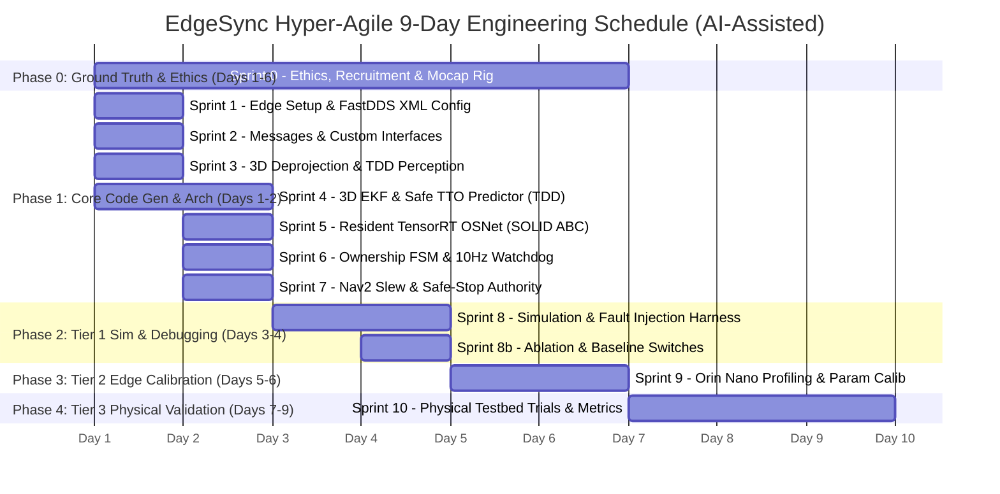

# 🚀 EdgeSync: Proactive TTO-Driven Decentralized Target Handoff for Dual JetAuto UGVs

[](https://docs.ros.org/en/humble/)
[-E95420?logo=ubuntu)](https://developer.nvidia.com/embedded/jetpack)
[](https://developer.nvidia.com/embedded/jetson-orin)
[-107C41)](https://fast-dds.docs.eprosima.com/)
[-76B900?logo=nvidia)](https://developer.nvidia.com/tensorrt)
[](System%20Design%20Phase/)

> **Graduation Project** | **Baseline:** FROZEN & CERTIFIED (v2.3 Architecture · Waves 1–3 Synced)  
> **Target Platform:** Dual Hiwonder JetAuto / JetAuto Pro UGVs (Mecanum Chassis)  
> **Core Focus:** Real-time multi-robot visual tracking, analytical Time-To-Occlusion (TTO) prediction, distributed consensus, and zero dual-ownership handoff.

---

## 📌 Project Overview

**EdgeSync** is an advanced decentralized multi-robot coordination framework designed for continuous, uninterrupted tracking of dynamic human targets across cooperative Unmanned Ground Vehicles (UGVs). By combining edge-accelerated analytical **Time-To-Occlusion (TTO)** estimation and deep visual Re-Identification (Re-ID), EdgeSync proactively forecasts line-of-sight loss and executes an atomic, bounded-latency target handoff to a peer robot before occlusion occurs—without centralized cloud/edge servers or raw video network streaming.

### 🛡️ 5 Non-Negotiable System Invariants

1. **Zero Dual-Ownership Invariant:** The state `COMMITTED` maintains Robot A as the sole authoritative tracker. Target ownership transfers strictly upon atomic exchange of `HANDOFF_CONFIRM_ACK` with monotonic epoch increment $e \to e+1$. Receiver enters `TRACKING` only if ACK is received within $T_{ack} = 100\text{ ms}$ (local monotonic clock). Sender starts $T_{claim} = 200\text{ ms}$ upon sending ACK; if claim/heartbeat fails to arrive within $T_{claim}$, Sender reclaims target at epoch $e+2$. Highest epoch wins all arbitrations ($e+2 > e+1$).
2. **Deterministic Latency Budget:** Nominal execution budget $\Delta t_{exec} \le 866\,\text{ms}$, bounded by a strict transaction window $T_{txn} = 886\,\text{ms}$ with hard acquisition cutoff $T_{acq\_cutoff} = 700\,\text{ms}$ to ensure handover completion prior to target occlusion.
3. **Anti-Deadlock Liveness Invariant:** Continuous 10 Hz `ACQ_STATUS` heartbeats (dedicated callback group) armed immediately upon `HANDOFF_ACCEPT`. A 300 ms watchdog (3 missed heartbeats) preemptively raises `ERR_CANDIDATE_DEAD` and transitions to `RECOVERY`, guaranteeing zero hung states.
4. **Spatial Reference Consistency:** All inter-robot target states, velocities, and covariances are anchored in a common metric `map` frame via `tf2_ros`. Measurement ego-motion uncertainty is strictly propagated into measurement covariance ($R_{total} = J_c R_{cam} J_c^T + J_\xi \Sigma_\xi J_\xi^T$) exactly once in the estimation engine (C-02).
5. **Edge Resource & Resident Inference Invariant:** Deep feature extractors (512-dimensional OSNet) and detectors (YOLO TensorRT engine) are pre-warmed and resident in unified memory, guaranteeing zero dynamic allocation latency during active handoff.

---

## 🏗️ Repository Architecture

```
EdgeSync/
├── EdgeSync_Implementation_Plan_v1.0_2.md     # Certified Master Implementation Plan (v1.0/v2.3)
├── EdgeSync_Implementation_Plan_v1.0.md       # Synchronized Master Plan mirror
├── EdgeSync_Architectural_Sync_Report_Waves_1_2_3.md # Comprehensive Engineering Synchronization Report
├── README.md                                  # Main project documentation & entry point
├── Hardware Description/                      # Robot specifications and hardware manuals
│   ├── JetAuto User Manual.pdf                # Hiwonder JetAuto comprehensive manual
│   └── jetauto_technical_specifications.md    # Orin Nano, STM32F407, sensor bus details
├── Market Resaerch/                           # Competitive analysis and market research
│   └── Complete Market Research.docx          # Market evaluation document
├── Software Digrams/                          # Full architectural diagrams & assets (v2.3)
│   ├── 1_Component_Diagram.html               # Component architecture & 18 explicit interfaces
│   ├── 2_StateMachine_Diagram.html            # 10-state Sender & 8-state Receiver FSMs
│   ├── 3_Sequence_Diagram_Success.html        # Nominal handoff sequence & monotonic clocks
│   ├── 4_Sequence_Diagram_Failure.html        # Abort, netem loss, and rollback recovery
│   ├── 5_Activity_Diagram.html                # End-to-end operational activity flow
│   ├── 6_Deployment_Diagram.html              # Jetson Orin Nano + STM32 dual-layer topology
│   ├── 7_ROS2_Node_Graph.html                 # Inter-node topics, services, & namespaces
│   ├── 8_Class_Diagram_Data_Model.html        # SOLID abstractions & composed IDL data model
│   ├── 9_Timing_Diagram.html                  # Deterministic execution budgets (886ms/700ms)
│   ├── capture_diagrams.js                    # Automated headless Chrome diagram renderer
│   └── Digrams Photos/                        # High-resolution rendered PNG diagrams (300 DPI)
│       ├── 1_Component_Diagram.png
│       ├── 2_StateMachine_Diagram.png
│       ├── 3_Sequence_Diagram_Success.png
│       ├── 4_Sequence_Diagram_Failure.png
│       ├── 5_Activity_Diagram.png
│       ├── 6_Deployment_Diagram.png
│       ├── 7_ROS2_Node_Graph.png
│       ├── 8_Class_Diagram_Data_Model.png
│       └── 9_Timing_Diagram.png
├── System Design Phase/                       # Certified System Engineering Documents (v2.3)
│   ├── 1_Literature_Review_Final.html         # Literature review & prior state-of-the-art
│   ├── 2_SRS_v1.3.html                        # Software Requirements Specification (v1.3)
│   ├── 3_SAD_v2.3.html                        # Software Architecture Document (v2.3)
│   ├── 4_Math_Protocol_ROS2_v2.3.html         # Mathematical formulations & protocol spec (v2.3)
│   └── 5_Experimental_Design_v1.1.html        # Empirical evaluation & validation protocols
└── Implementation Phase/                      # ROS 2 Python implementation packages (rclpy)
    └── .gitkeep
```

---

## 📐 System Architecture & Diagrams (Certified v2.3)

| Diagram | Core Technical Focus | High-Res Preview |
|:---|:---|:---:|
| **1. Component Diagram** | 12 subsystems, 18 explicit interfaces (`I-01` to `I-18`), SOLID abstractions | [Open Preview](Software%20Digrams/Digrams%20Photos/1_Component_Diagram.png) |
| **2. State Machine** | 10-state Sender & 8-state Receiver FSMs, epoch $e+2$ recovery, cyclic loops | [Open Preview](Software%20Digrams/Digrams%20Photos/2_StateMachine_Diagram.png) |
| **3. Nominal Sequence** | Monotonic $T_{ack}$ (100ms) & $T_{claim}$ (200ms), 3x `OWNER_CLAIM` burst | [Open Preview](Software%20Digrams/Digrams%20Photos/3_Sequence_Diagram_Success.png) |
| **4. Failure Sequence** | Watchdog cutoff (300ms/700ms), netem packet drop, rollback & solo tracking | [Open Preview](Software%20Digrams/Digrams%20Photos/4_Sequence_Diagram_Failure.png) |
| **5. Activity Diagram** | Dual swimlanes, hard gate $G(j)$, utility $U_j$, 4-step admission policy | [Open Preview](Software%20Digrams/Digrams%20Photos/5_Activity_Diagram.png) |
| **6. Deployment Model** | JetPack 6.0, TensorRT 8.6, FastDDS shared memory, STM32 FreeRTOS deadman | [Open Preview](Software%20Digrams/Digrams%20Photos/6_Deployment_Diagram.png) |
| **7. ROS 2 Node Graph** | Multi-robot `/{robot_id}/edgesync/` isolation, C-08 acquisition package | [Open Preview](Software%20Digrams/Digrams%20Photos/7_ROS2_Node_Graph.png) |
| **8. Class Diagram** | Composed `HandoffHeader.msg`, `OwnershipEvent.msg`, `IdentityVerify.srv` | [Open Preview](Software%20Digrams/Digrams%20Photos/8_Class_Diagram_Data_Model.png) |
| **9. Timing Diagram** | Deterministic timing breakdown: $T_{txn} = 886\,\text{ms}$, $T_{cutoff} = 700\,\text{ms}$ | [Open Preview](Software%20Digrams/Digrams%20Photos/9_Timing_Diagram.png) |

---

## ⏱️ Certified Timing Registers & Budgets (`timing_budgets.yaml`)

All timing budgets and protocol thresholds are strictly declared as ROS 2 parameters—**zero hardcoding permitted in source code**:

```yaml
timing_budgets:
  ros__parameters:
    dt_dec_ms: 20                       # Decision latency budget
    dt_neg_ms: 60                       # P2P negotiation network budget
    t_neg_timeout_ms: 80                # Negotiation hard cutoff
    dt_acq_ms: 600                      # Slew & visual acquisition budget
    t_acq_cutoff_ms: 700                # Acquisition hard timeout cutoff
    dt_id_ms: 120                       # OSNet embedding extraction & cosine match
    dt_conf_ms: 66                      # Confirmation exchange budget
    sigma_total_ms: 120                 # Cumulative execution standard deviation
    delta_sync_ms: 2                    # Allowable clock synchronization offset
    t_txn_ms: 886                       # Total maximum transaction window
    watchdog_period_ms: 100             # Liveness heartbeat period (10 Hz)
    watchdog_max_missed: 3              # Max consecutive missed heartbeats (300 ms)
    t_ack_ms: 100                       # Receiver ACK wait window (local monotonic)
    t_claim_ms: 200                     # Sender claim confirmation window (local monotonic)
    confirm_retry_count: 3              # HANDOFF_CONFIRM retransmissions
    confirm_retry_period_ms: 30         # Confirmation retransmission period
    owner_claim_burst: 3                # OWNER_CLAIM publication burst count
    owner_claim_burst_period_ms: 20     # Burst inter-packet delay
    owner_claim_latency_budget_ms: 60   # Total burst window budget
    txn_tombstone_ttl_ms: 10000         # Stale transaction tombstone TTL (10 s)
    peer_telemetry_max_age_ms: 2500     # Maximum allowable peer telemetry age
    cmd_vel_watchdog_ms: 150            # STM32 hardware deadman timer
```

---

## 📦 ROS 2 Python Package Structure

The system is structured into 9 modular ROS 2 packages adhering to the **Single Responsibility Principle (SRP)** and **Dependency Inversion Principle (DIP)**:

1. **`edgesync_msgs`**: Custom IDL definitions (`CMakeLists.txt` for `rosidl_default_generators`). Standardized under `/{robot_id}/edgesync/` with composed `HandoffHeader.msg`, `OwnershipEvent.msg`, and `IdentityVerify.srv`.
2. **`edgesync_perception`**: Real-time 2D-to-3D perception (`YoloTrtDetector`, `ByteTrackMOT`, metric depth deprojection) publishing camera-frame centroids $\mathbf{p}_c$.
3. **`edgesync_estimation`**: 6-DoF Target EKF, ego-motion covariance inflation ($R_{total}$), and analytical 3D FOV frustum/obstacle raycasting TTO predictor.
4. **`edgesync_identity`**: Resident TensorRT OSNet Re-ID feature extractor (512-dim), exponential moving average buffer, and cosine similarity verifier.
5. **`edgesync_coordination`**: 10-state Sender & 8-state Receiver FSMs, monotonic epoch manager, eligibility gates, utility engine, and 10 Hz liveness watchdog.
6. **`edgesync_navigation`**: Nav2 Mecanum integration (`BasicNavigator`) and intercept trajectory generation.
7. **`edgesync_acquisition`** (C-08): Dedicated acquisition controller (`target_acquisition_node.py`) and dedicated callback group heartbeat publisher (`liveness_publisher.py`).
8. **`edgesync_observability`**: Event logging, telemetry monitor, dynamic parameter server, and offline Mocap ground-truth evaluation pipeline.
9. **`edgesync_bringup`**: Coordinated multi-robot launch scripts, FastDDS XML transport profiles, and YAML parameter configurations.

---

## ⚙️ Hardware & Software Baseline

### Hardware Platform
* **UGV Chassis:** 2x Hiwonder JetAuto / JetAuto Pro (Mecanum 4WD omnidirectional base)
* **Primary Edge Compute:** NVIDIA Jetson Orin Nano (8 GB Unified LPDDR5, 1024-core Ampere GPU, 40W total platform power)
* **Low-Level Microcontroller:** STM32F407VET6 (168 MHz ARM Cortex-M4, FreeRTOS for motor velocity PID, deadman timer, and IMU)
* **Chassis Safety Authority:** Dual-layer: ROS 2 `safety_authority_node` (C-10) ramp-down + STM32 FreeRTOS independent hardware deadman watchdog (`cmd_vel_watchdog_ms = 150ms`)
* **Perception Sensors:**
  * **RGB-D Camera:** Orbbec Astra Pro Plus (Monocular structured light depth, 3D metric deprojection)
  * **LiDAR:** 2D RPLiDAR (Local SLAM, obstacle avoidance, Nav2 costmaps)
* **Inter-Robot Network:** Ad-Hoc 5 GHz Wi-Fi mesh / peer-to-peer DDS domain ($\delta_{sync} \le 2\,\text{ms}$ via PTP/IEEE 1588v2)

### Software Platform
* **Operating System:** JetPack 6.0 (Ubuntu 22.04 LTS Jammy, Linux Kernel 5.15)
* **Middleware:** ROS 2 Humble Hawksbill (`rclpy` exclusively for application and lifecycle nodes)
* **DDS Transport:** eProsima FastDDS 2.x (Shared Memory 1-Copy IPC, tuned reliable writer: `heartbeatPeriod=10ms`, `nackResponseDelay=1ms`)
* **Neural Runtime:** TensorRT 8.6 with PyCUDA acceleration (INT8 / FP16 engines resident in unified memory)
* **Testing Framework:** `pytest` unit test suites for pure math + `hypothesis` property-based testing for FSM state invariants under network fault injection

---

## 🗓️ Engineering Roadmap (11 Sprints)



---

## 📄 License & Attribution

Developed by **Mustafa Mohamed** ([@Mustafa700aa](https://github.com/Mustafa700aa)) as part of the Graduation Project.  
All architectural designs, mathematical models, and implementation specifications are certified under standard academic research and open robotics engineering guidelines.
